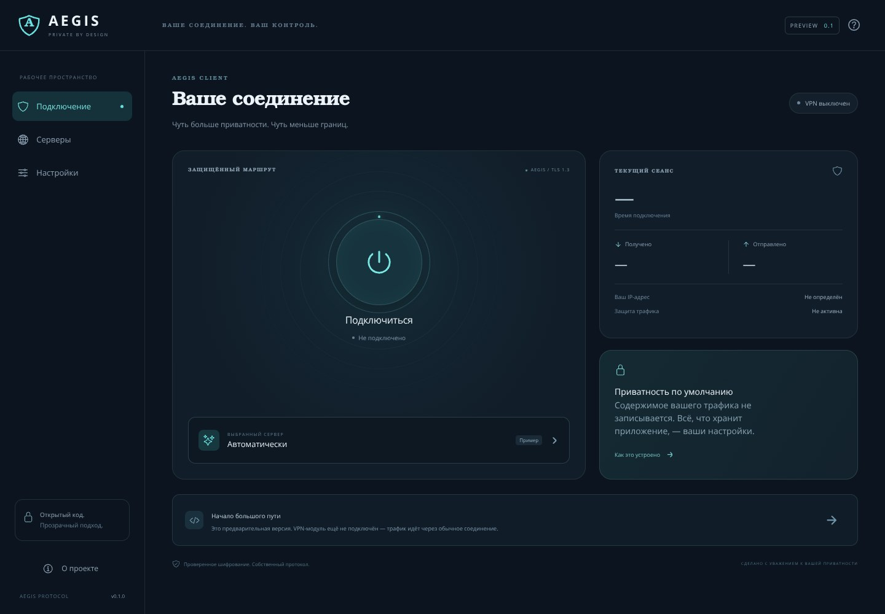

# Aegis Protocol

Экспериментальный независимый протокол туннелирования. Версия **0.1.0** — запускаемый прототип защищённого двустороннего обмена бинарными данными на Rust. Собственные framing, согласование лимитов, идентификаторы потоков и автомат состояний; криптография предоставляется TLS 1.3.

**Сетевое ядро сейчас выполняет multiplexed echo; это ещё не готовый VPN.** Для интерфейса выбран **Ionic React + Capacitor**. Каркас `apps/ionic/` предназначен для запуска интерфейса и разработки типизированного моста; нативного VPN-модуля в нём пока нет. TUN, маршрутизация TCP/UDP/IP, DNS, kill switch, Control API и интеграция панели ещё не реализованы. Устойчивость к DPI не измерена; ALPN `aegis/0.1` позволяет распознать транспорт. Невозможность блокировки не обещается. До публичного сервиса необходим независимый аудит.

## Архитектура v0.1

| Путь | Реализовано |
| --- | --- |
| `protocol/` | Проверяемый 20-байтный заголовок, строгая последовательность кадров, Hello/Welcome |
| `transports/` | TCP + TLS 1.3, обязательный mTLS, проверка CA и имени сервера, ALPN |
| `core/` | Независимый от TLS автомат сессии, до 16 логических потоков, echo, ping, FIN, close |
| `server/` | Linux/Windows CLI, до 64 соединений с учётом рукопожатий, ограниченное завершение |
| `client-cli/` | CLI и библиотека проверки двустороннего бинарного обмена |
| `apps/ionic/` | Ionic React UI и типизированный контракт Capacitor-моста; Web-режим не устанавливает VPN |
| `tests/` | Локальные реальные TCP/TLS-тесты с временными сертификатами; генератор dev PKI |
| `fuzz/` | Фаззинг заголовка и сообщений согласования через libFuzzer |
| `docs/` | Архитектура, модель угроз, исследования транспортов, roadmap и результаты проверок |
| `control-api/`, `integrations/3x-ui/` | Документированные следующие этапы, без исполняемой интеграции |

Общее ядро использует `AsyncRead + AsyncWrite`: TLS отделён от формата протокола. QUIC потребует отдельного отображения потоков/датаграмм, а не механической замены сокета. Код Xray/VLESS/WireGuard не заимствован.

## Библиотеки

- **Tokio 1.x**: асинхронные сокеты, таймауты, ограничение числа задач и корректное завершение.
- **rustls 0.23.46+ / tokio-rustls 0.26 / ring**: TLS 1.3 и стандартные AEAD/обмен ключами без собственной криптографии; TLS 1.2, 0-RTT и возобновление сессий отключены. Версия rustls выбрана с учётом исправлений безопасности, доступных при реализации.
- **rustls-pki-types**: поддерживаемый PEM API через rustls, загрузка только обычных файлов до 1 МиБ; **zeroize**: очистка промежуточного буфера ключа; **clap 4**: CLI; **thiserror 2**: типизированные ошибки.
- **rcgen 0.13** и **tempfile 3**: только тесты и локальная PKI. Ключи генерируются при запуске, в Git не хранятся.

`Cargo.lock` фиксирует реально разрешённые версии. Официальные источники и причины выбора: [docs/ARCHITECTURE.md](docs/ARCHITECTURE.md), [docs/TRANSPORT_RESEARCH.md](docs/TRANSPORT_RESEARCH.md).

## Интерфейс Ionic React

Общий интерфейс использует [компоненты Ionic](https://ionicframework.com/docs/components), React и TypeScript. Capacitor выбран для мобильных оболочек Android/iOS. Для Linux добавлена настольная оболочка Tauri 2 с тем же интерфейсом. Она пока не связана с сетевым Rust-ядром и не устанавливает VPN.

**Установка и разработка на Arch Linux:** [docs/ARCH_LINUX.md](docs/ARCH_LINUX.md). Установщик собирает приложение и добавляет ярлык в меню для текущего пользователя; запускать его через sudo не нужно.

Сборка интерфейса требует Node.js 22 или новее. Инструкции каркаса: [apps/ionic/README.md](apps/ionic/README.md). Границы web/native, требования Android/iOS и порядок интеграции Rust: [docs/CLIENT_ARCHITECTURE.md](docs/CLIENT_ARCHITECTURE.md). Текущий Rust CLI запускается независимо от интерфейса по инструкциям ниже.

Реальные снимки текущего интерфейса: [мобильный экран](docs/previews/mobile.jpg) · [десктопный экран](docs/previews/desktop.jpg). Это оболочка с примерами серверов, без активного системного VPN.



## Запуск: Linux

Установите стабильный Rust через [rustup](https://rustup.rs/), C-компилятор и linker (Ubuntu/Debian: `build-essential`). Минимальная заявленная версия Rust — 1.88; используйте актуальный stable. Фактически проверенная версия указана в [VALIDATION.md](docs/VALIDATION.md).

```bash
git clone https://github.com/webar4i/aegis-protocol.git
cd aegis-protocol
cargo build --locked --workspace
cargo test --locked --workspace
cargo run --locked -p aegis-integration-tests --example dev-pki -- dev-pki
```

Терминал 1:

```bash
cargo run --locked -p aegis-server -- --listen 127.0.0.1:8443 --ca dev-pki/ca.pem --cert dev-pki/server.pem --key dev-pki/server.key
```

Терминал 2:

```bash
cargo run --locked -p aegis-client -- --server 127.0.0.1:8443 --server-name localhost --ca dev-pki/ca.pem --cert dev-pki/client.pem --key dev-pki/client.key --message 'Hello, Aegis!'
```

Ожидаемый результат: `Verified 13 bytes over Aegis v0.1; session closed cleanly.` Содержимое сообщения не печатается. Для остановки сервера используйте Ctrl+C или SIGTERM на Unix; завершение активных сессий ограничено 5 секундами.

## Запуск: Windows 10/11

Установите [Rust для Windows](https://www.rust-lang.org/tools/install) и Visual Studio Build Tools с компонентом **Desktop development with C++**, включая Windows SDK. Откройте PowerShell в каталоге проекта. Wintun и права администратора для echo не нужны.

```powershell
cargo build --locked --workspace
cargo test --locked --workspace
cargo run --locked -p aegis-integration-tests --example dev-pki -- dev-pki
cargo run --locked -p aegis-server -- --listen 127.0.0.1:8443 --ca dev-pki/ca.pem --cert dev-pki/server.pem --key dev-pki/server.key
```

Во втором PowerShell выполните ту же команду клиента, что для Linux, заменив сообщение при желании на `--message "Hello, Aegis!"`. На Windows защитите каталог `dev-pki` ACL своей учётной записи. Реальный статус проверки Windows смотрите в VALIDATION; наличие инструкции само по себе не означает успешный запуск.

## Проверка бинарного файла

```bash
cargo run --locked -p aegis-client -- --ca dev-pki/ca.pem --cert dev-pki/client.pem --key dev-pki/client.key --input input.bin --output echoed.bin
```

Максимальный ввод CLI — 1 МиБ; данные разбиваются на кадры до 16 КиБ. Результат записывается после проверки каждого байта и корректного завершения сессии. `--output` заменяет существующий файл.

## Аутентификация и ограничения

Сервер проверяет обязательный клиентский сертификат, клиент — сертификат сервера и SAN `--server-name`. **Каждый действительный сертификат, выпущенный доверенным клиентским CA, авторизован.** Отзыв устройств, пользовательские квоты и биллинг пока отсутствуют. Dev CA нельзя использовать как production CA; для удалённого сервера нужен сертификат с его настоящим именем, отключать проверку нельзя.

Лимиты прототипа: 16 КиБ на кадр, до 16 открытых потоков, 16 МиБ DATA суммарно в обе стороны на сессию, 65 536 кадров на направление, 1 час на сессию, 10 секунд на TCP/TLS и Hello, 30 секунд на чтение/запись целого кадра. Переполнение и нарушение состояния закрывают соединение. Это ограничения ресурсов, не тарифы и не rate limiter.

Сервер выводит только локальный адрес запуска, остановку и общий сбой задачи. Содержимое трафика, удалённые IP, имена сертификатов и посещённые адреса не журналируются; технические счётчики существуют в памяти сессии и не сохраняются. ОС, хостинг и внешний сборщик журналов могут иметь собственный учёт. [Полная модель угроз](docs/THREAT_MODEL.md).

## Проверки и дальнейшая разработка

```bash
cargo fmt --all -- --check
cargo clippy --locked --workspace --all-targets -- -D warnings
cargo test --locked --workspace
cargo install cargo-audit --locked
cargo audit --deny warnings
```

Для фаззинга установите nightly и `cargo-fuzz`, затем из корня:

```bash
cargo +nightly fuzz run frame_parser -- -max_total_time=30 -max_len=20000
```

Фактические результаты и непроверенные свойства: [docs/VALIDATION.md](docs/VALIDATION.md). Спецификация: [PROTOCOL.md](PROTOCOL.md). Сообщения об уязвимостях: [SECURITY.md](SECURITY.md).

Следующая задача — локальный Linux TUN: определить IP_PACKET и параметры MTU, проверять IPv4/IPv6 до передачи, организовать ограниченные очереди и адресное пространство сессий, затем проверить TCP/UDP/DNS в изолированных network namespaces. План: [docs/ROADMAP.md](docs/ROADMAP.md).

## Лицензия

Apache-2.0. Совместимость будущего кода интеграции с GPL-3.0 3x-ui требует отдельной проверки; код панели в этот репозиторий не включён.
